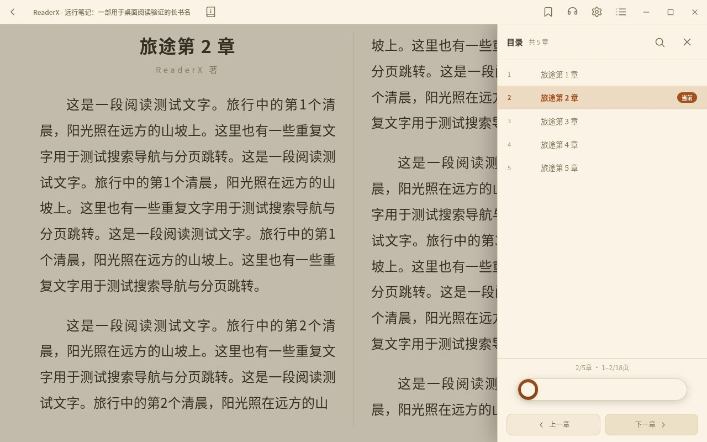

# 桌面标题栏与阅读操作

仅 Tauri 桌面平台且窗口宽度 ≥900px 时合并页头，判断入口为
`src/shell/pageTitle.ts` 的 `usesWindowPageTitle()`。宽屏标题栏高 44px，
原桌面窄窗口标题栏仍为 36px；Android 与普通浏览器保持页内标题和阅读菜单。

`PageHeader` 注册响应式 props，`DesktopTitleBar` 只选择当前路径的条目，
显示 `ReaderX - 页面标题`、弱化副标题、原返回回调和右侧操作。
`children` 中的搜索、筛选等继续留在页内。注册随组件卸载清理；
保活页由两个 Stage 经 `PageBody.pagePath` / `PageTitlePathContext` 提供固定路径，
避免切页后才完成的 lazy 组件注册到错误的路由。注册不得缓存已翻译标题的初值。

阅读器用同一入口注册译后书名、详情按钮与原工具栏动作，并增加目录按钮。
桌面不挂载原上下菜单，也不响应正文中间点按和上下贴边呼出；右侧贴边目录保留。
目录底部包含章节 / 页码上下文、可选本章页滑条、前后章节按钮和在线网页入口。
`ReaderDesktopChrome` 管搜索操作栏和目录底部布局；搜索栏占用的高度从分页可用高度中扣除。
听书期间右下角常驻原播放控制与返回跟读入口，不依赖 `menuOpen`。
自动翻页倒计时、返回原进度提示与阅读状态栏保持原布局。

全屏时隐藏原生窗口最小化 / 最大化 / 关闭按钮，保留同高的页面工具栏及退出全屏入口，
保证合并后的页面仍可返回和操作。窗口拖动与双击最大化只绑定标题文字区域，
全屏时禁用拖动与双击。退出全屏权限只授予桌面主窗口。

截图使用内存示例书籍和模拟窗口 IPC，不能代替原生平台验证。

## 回归检查

- `node scripts/desktop-page-title-test.mjs`：动态标题 / 副标题、保活页隔离、迟到加载、返回、卸载和平台分支。
- `node scripts/reader-position-transition-test.mjs`、`node scripts/reader-page-turn-test.mjs`：布局切换和翻页既有回归。
- 前端类型、i18n 与构建检查按前端技能执行。
- 界面核对 899px / 900px 断点、宽屏单双页、书架多选与主 Tab 切换；目录滑条点按 / 拖动首尾、前后章节、搜索命中导航与返回原进度；听书暂停 / 继续及全屏返回入口。
- 原生设备另查窗口拖动 / 双击 / 全屏、真实音频、在线网页与下载；Android 另查安全区和菜单手势。
